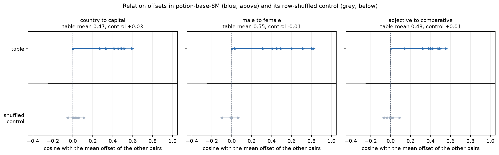
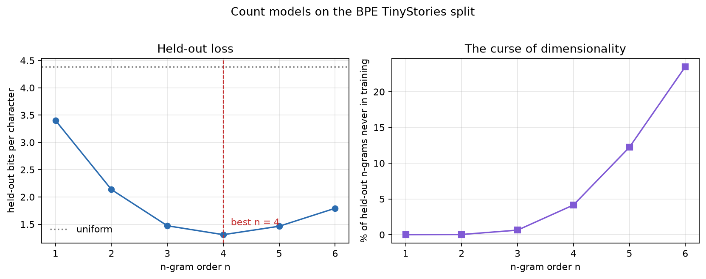
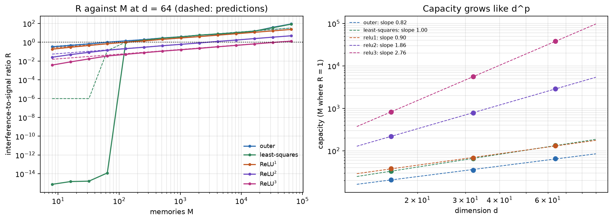
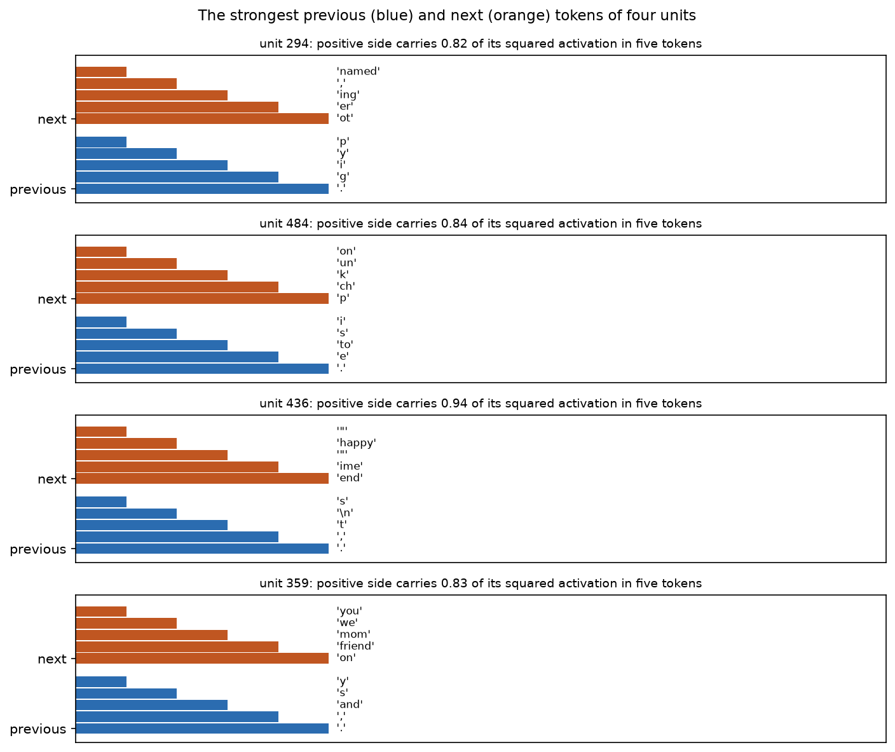
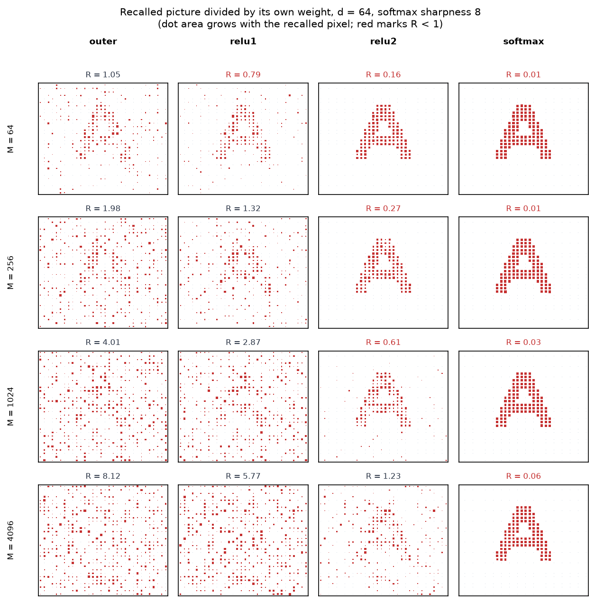
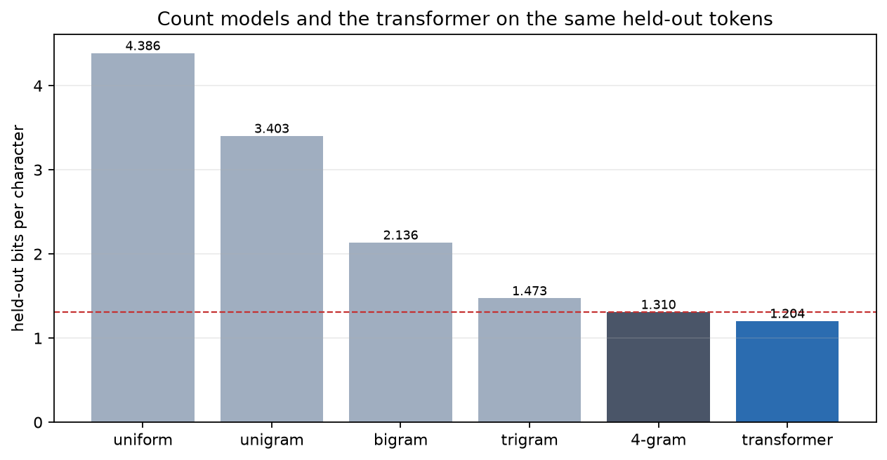
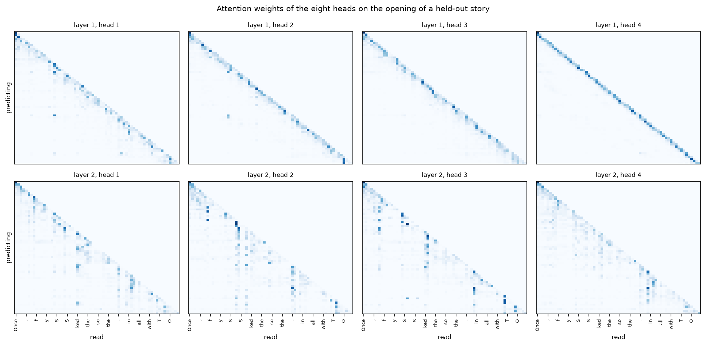
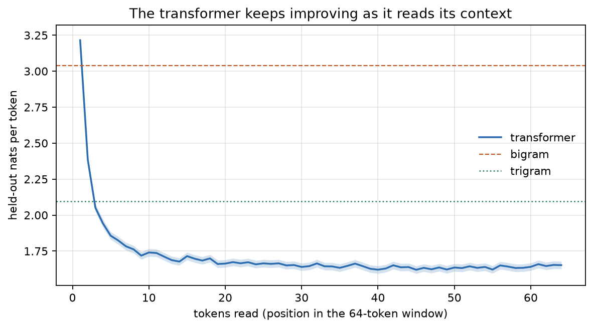
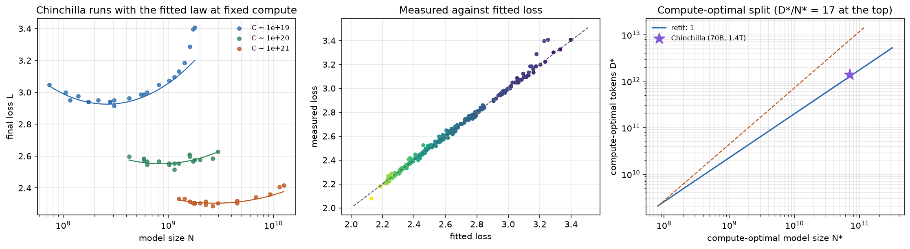

# Week 8: Language models and the transformer

How a language model assigns probabilities to text, and how it generates new
text: embeddings, count models, the MLP as a memory in its weights, attention as
a memory built from the text, a trained transformer, and the Chinchilla scaling
law. Every run fits on a laptop CPU.

## Setup

From `week8/`:

```sh
uv sync --extra test
uv run pytest
```

`uv.lock` records the reproducible environment. NumPy does the counts and the
checks, JAX does the models, and sentencepiece loads the BPE tokenizer.

## Inputs (kept out of git)

All downloads go to `week8/data/`, which `.gitignore` excludes.

| Input | Address |
| --- | --- |
| TinyStories corpus | `https://huggingface.co/datasets/roneneldan/TinyStories/resolve/f54c09fd23315a6f9c86f9dc80f725de7d8f9c64/TinyStoriesV2-GPT4-valid.txt` |
| BPE tokenizer, `tok512.model` | `https://huggingface.co/karpathy/tinyllamas/resolve/0bd21da/stories260K/tok512.model` |
| Embedding table, `model.safetensors` and `tokenizer.json` | `https://huggingface.co/minishlab/potion-base-8M/resolve/bf8b056/` |
| Chinchilla training runs | `https://raw.githubusercontent.com/epoch-research/analyzing-chinchilla/92258837425e1b5f2851d624287f0120583a3d0e/data/svg_extracted_data.csv` |

```sh
base=https://huggingface.co/datasets/roneneldan/TinyStories/resolve
rev=f54c09fd23315a6f9c86f9dc80f725de7d8f9c64
curl -L -o week8/data/TinyStoriesV2-GPT4-valid.txt "$base/$rev/TinyStoriesV2-GPT4-valid.txt"

mkdir -p week8/data/model2vec
curl -L -o week8/data/tok512.model \
  "https://huggingface.co/karpathy/tinyllamas/resolve/0bd21da/stories260K/tok512.model"
curl -L -o week8/data/model2vec/model.safetensors \
  "https://huggingface.co/minishlab/potion-base-8M/resolve/bf8b056/model.safetensors"
curl -L -o week8/data/model2vec/tokenizer.json \
  "https://huggingface.co/minishlab/potion-base-8M/resolve/bf8b056/tokenizer.json"
mkdir -p week8/data
curl -L -o week8/data/chinchilla-runs.csv \
  "https://raw.githubusercontent.com/epoch-research/analyzing-chinchilla/92258837425e1b5f2851d624287f0120583a3d0e/data/svg_extracted_data.csv"
```

Raw runs and figures land in the ignored `artifacts/`; only `evidence/` figures
are committed.

## The tokenizer

`scripts/tinystories.py` splits the corpus at `<|endoftext|>`, strips each
story, drops the empty ones, keeps the first 90% for training and the rest for
validation, and encodes both splits with the 512-token BPE, with the
end-of-sequence id `2` between stories. The split holds **24 867 training and
2 763 validation stories**, the BPE covers **2.0538 characters per token** on
the training text (2.0518 on validation), and decoding returns **24 796 of the
24 867** training and **2 760 of the 2 763** validation stories exactly — the
lost ones merged a double space into one. Every loss below depends on both
numbers, so the token cache in `artifacts/tinystories-split.npz` is rebuilt from
`data/` and never committed.

## Part 1: embeddings

```sh
uv run python scripts/embeddings.py
```

Loads `potion-base-8M` (29 528 x 256) with `safetensors`, no PyTorch, and makes
a control copy whose rows are shuffled by seed 1730. For each relation, each
pair's unit offset is compared with the mean offset of the other eight.

| Relation | Table mean cosine | Shuffled control | Weakest pair |
| --- | --- | --- | --- |
| country to capital | **+0.466** | +0.029 | peru → lima (+0.304) |
| male to female | **+0.549** | −0.015 | husband → wife (+0.066) |
| adjective to comparative | **+0.433** | +0.009 | old → older (+0.173) |

Over 20 shuffles no control mean leaves ±0.09. All three table means clear 0.3,
as the sheet requires, and the weakest pairs are the same two the reference
names.



## Part 2: count models

```sh
uv run python scripts/ngram_ladder.py
```

Builds add-k smoothed n-gram models for n = 1…6 on packed int64 context keys,
choosing k from {1e-4, 1e-3, 1e-2, 1e-1, 1} on the last 10% of *training* tokens
(never on validation), then reports held-out cross-entropy in nats per token,
perplexity, and bits per character.

| Model | Nats / token | Perplexity | Bits / character |
| --- | --- | --- | --- |
| uniform | 6.238 | 512 | 4.386 |
| unigram (n = 1) | 4.839 | 126.4 | 3.403 |
| bigram (n = 2) | 3.038 | 20.87 | 2.136 |
| trigram (n = 3) | 2.094 | 8.12 | 1.473 |
| 4-gram | **1.863** | 6.44 | **1.310** |
| 5-gram | 2.083 | 8.03 | 1.464 |
| 6-gram | 2.550 | 12.81 | 1.793 |

Checks:

* **Exact normalization.** Enumerating every sequence of length 1, 2 and 3 gives
  sums 1, 1 + 2.0e-15, 1 + 2.9e-15, so the worst error is **2.9e-15** (the sheet
  allows 1e-12). The same enumeration with the unnormalized scores
  `exp(n(ab) / max n)` gives 540, 2.8e5 and 1.4e8 instead of one.
* **Samples follow the bigram.** 250 000 ancestral tokens, the 20 most frequent
  contexts pooled: χ² = 1192.6 on 1211 degrees of freedom, **p = 0.64**
  (reference 0.37). A sampler conditioned on the token two places back gives
  p = 0.
* **The curse of dimensionality.** The held-out loss is lowest at **n = 4** and
  then rises; the fraction of held-out n-grams never seen in training is
  0.03%, 0.63%, 4.15%, 12.22% and **23.50%** for n = 2…6, matching the
  reference's 0.6%, 4.2%, 12.2% and 23.5% for n = 3…6.



## Part 3: memories in the weights

### Key-value stores

```sh
uv run python scripts/memory_stores.py
```

M unit keys and values in d dimensions; the interference-to-signal ratio is the
leak over the wanted value, median over independent draws and queried keys.
Capacity is the M where R crosses one, interpolated on log-log axes.

At d = 64: outer product **65.1** (predicted 64), least squares **133** (128),
ReLU¹ **131** (128), ReLU² **2887** (2731), ReLU³ **37 939** (34 953). Least
squares answers its stored keys to 1e-14 up to M = 64 and only then rises.
Fitted capacity slopes: outer 0.82, least squares 1.00, ReLU¹ 0.90, ReLU² 1.84,
ReLU³ 2.71; every curve rises with slope ½ once R passes 0.1.



### The MLP language model

```sh
uv run python scripts/mlp_lm.py        # 4000 AdamW steps of 16384 examples
uv run python scripts/mlp_lm.py --resume   # reuse the saved weights
```

A 64-dimensional embedding, one hidden layer of 512 tanh units, and a softmax
readout: 4000 AdamW steps of 16384 examples at learning rate 0.006 with warmup
and cosine decay. Held-out **3.0433 nats per token**, within **+0.005** of the
bigram's 3.038 — the sheet allows 0.01. The model sees exactly what the bigram
sees, so this is a check on training, not a feature of the network.

Read as memories, the units are not clean: the median share of a side's squared
activation carried by its five strongest previous tokens is **0.376**, against
**0.414** for the untrained network — the trained model spreads each bigram row
over many units, as the reference reports.



## Part 4: memories from the text

```sh
uv run python scripts/attention_recall.py
```

A 32 x 32 picture of "A" (+1 ink, −1 background) stored as one value among M
random ±1 pictures with random unit keys in d = 64, recalled with its own key and
divided by its own weight.

| M | outer | ReLU | ReLU² | softmax, β = 8 |
| --- | --- | --- | --- | --- |
| 64 | 1.05 | 0.79 | 0.16 | 0.007 |
| 256 | 1.98 | 1.32 | 0.27 | 0.013 |
| 1024 | 4.01 | 2.87 | 0.61 | 0.028 |
| 4096 | 8.12 | 5.77 | **1.23** | **0.057** |

At M = 1024 the outer-product and ReLU ratios are 4.01 and 2.87, within 15% of
the predicted 4 and 2.83. The character is only readable while R < 1: the outer
product store barely shows it at M = 64, ReLU loses it from M = 256, ReLU² keeps
it to M = 1024 and fails at M = 4096, beyond its capacity of about 2731. The
softmax store stays far below R = 0.1 everywhere (0.057 at M = 4096, against the
predicted 0.058), so the picture looks the same in every row — its capacity of
about 1.2 million lies beyond the largest store here.



## Part 5: the transformer

```sh
uv run python scripts/train_transformer.py     # 6000 steps, about 5 minutes
uv run python scripts/train_transformer.py --resume   # re-score saved weights
```

A pre-norm decoder: learned position vectors added to the token embeddings, then
two blocks of (layer norm → 4-head causal attention → residual) and
(layer norm → GELU MLP 4x wider → residual), then layer norm and a readout. Every
linear map has a bias. Width 96, context 64; 6000 AdamW steps of 32 sequences of
65 consecutive tokens at learning rate 0.003 with 300 warmup steps and cosine
decay to a tenth.

Held-out **1.7118 nats per token = 1.204 bits per character**, below the best
count model (the 4-gram's 1.310) and a shade under the reference's 1.207.
Training took 295 s.

### Model comparison and samples

```sh
uv run python scripts/compare_models.py
```



One 60-token sample per model at temperature 1, seed 1848, after the prompt
"Once upon a time", in order of bits per character:

| Model | Bits / char | Sample |
| --- | --- | --- |
| uniform | 4.386 | `\x19R for>Ḩ…d 4d/5myithBgch… bev…fd… On> so(…P… saidrE…d""Z…nts…` |
| unigram | 3.403 | `uinmo pyen playsir " ms and. wu r rerut named,otuue weyoheu theaw litt` |
| bigram | 2.136 | `, but not kitepothir. Tim liked and a mose as they caterf." Then the m` |
| trigram | 1.473 | `there was a little bosa and her plants to make the truckily around. Th` |
| 4-gram | 1.310 | `, in a small poé… bigQ_u$ ha… kn… upon8…U…Hon n……€all…d4$;$ Hex…B` |
| transformer | **1.204** | `, there was a sour chubby dog named Max. Max had a big smile in forest` |

Each step up the ladder makes the samples read more like English: uniform tokens
give byte noise, single-token counts give letter soup, pairs and triples give
words and short phrases that do not join up, and the transformer keeps a
sentence together.

### Where the heads look



### The transformer uses its whole context

```sh
uv run python scripts/transformer_checks.py
```

Held-out token stream cut into consecutive 64-token windows, scored from each
window's first token. Over the last 8 positions the mean loss is **1.645 nats**
per token, below the trigram's 2.094. With one token read it is worse than the
bigram (which counts every training pair), it passes the trigram after a few
tokens, and it keeps improving to 64 — where the trigram stops reading after 2.



### Each sampler draws from its target distribution

Same script. From one fixed context with a broad next-token distribution
(entropy 3.54 nats), 100 000 draws per sampler:

| Sampler | Support | χ² | dof | p |
| --- | --- | --- | --- | --- |
| temperature 0.8 | 512 | 70.0 | 71 | **0.512** |
| top-k 20 at T = 0.8 | 20 | 21.1 | 19 | **0.333** |
| top-p 0.9 at T = 0.8 | 25 | 20.5 | 24 | **0.670** |
| min-p 0.1 at T = 0.7 | 19 | 18.4 | 18 | **0.431** |

Every p-value clears 0.001. Temperature 0.0001 returns the most likely token
every time. The negative control — a top-p sampler that *drops* the token
crossing the threshold — gives p = 0.

### The model's samples are as surprising as it predicts

Same script: 128 sequences of 128 tokens. At T = 1 the mean surprise minus the
mean predicted entropy is +0.0032 ± 0.0103 nats per token, **z = +0.3** (must lie
within ±4). At T = 0.7, scored by the temperature-1 model, the difference is
−0.4386 nats per token, **z = −65** (must exceed 40 in size): text sampled at a
lower temperature is far less surprising than the model predicts.

## Part 6: scaling laws

```sh
uv run python scripts/scaling_law.py
```

240 of the 245 Chinchilla runs after dropping the five highest losses, with
D = C / (6N). The law is fitted by the Huber loss of log L (δ = 0.001) with
L-BFGS from a grid of 243 starts, then refitted on 400 bootstrap resamples.

| Parameter | Refit | Standard error | Sheet's target |
| --- | --- | --- | --- |
| E | **1.8172** | ±0.0254 | 1.75–1.90 |
| A | 477.8 | ±124 | — |
| B | 2143 | ±1082 | — |
| α | **0.3473** | ±0.0155 | 0.32–0.38 |
| β | **0.3672** | ±0.0198 | 0.32–0.42 |

These reproduce the replication (0.347 ± 0.014, 0.367 ± 0.021, E = 1.817 ± 0.025).

* **The printed parameters miss the runs.** Mean residual of log L (predicted
  minus measured) is **−0.0007** for the refit (must be within ±0.005) and
  **+0.0167** for the printed E = 1.69, A = 406.4, B = 410.7, α = 0.34,
  β = 0.28 — about 1.7% too high for almost every run.
* **About 20 tokens per parameter.** At C = 5.76e23 FLOP the refit gives
  D\*/N\* = **17.9**, 95% bootstrap interval 7.8 to 37.3, which holds
  Chinchilla's 20. N\* grows like C^0.51 and D\* like C^0.49. The printed
  parameters give 92.6 tokens per parameter and a model a third of Chinchilla's
  size — the law the paper printed does not support the model the paper built.



## Layout

```
week8/
  scripts/     tinystories.py, embeddings.py, ngram.py, ngram_ladder.py,
               memory_stores.py, mlp_lm.py, attention_recall.py,
               transformer.py, samplers.py, train_transformer.py,
               transformer_checks.py, compare_models.py, scaling_law.py
  tests/       ngram, samplers, memory stores, embeddings, transformer, scaling law
  evidence/    the figures above
  artifacts/   raw runs and settings (ignored)
  data/        downloads (ignored)
```
